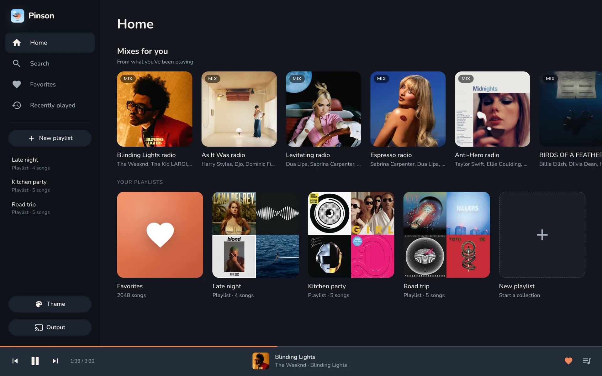
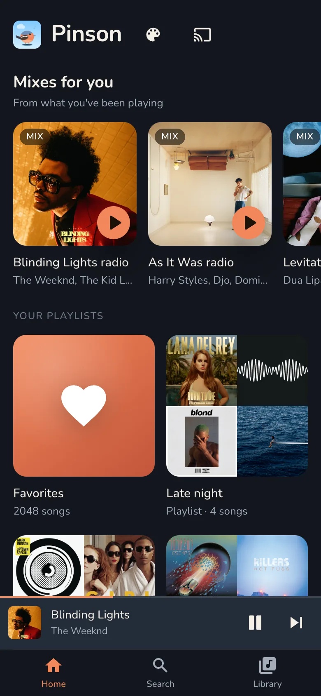
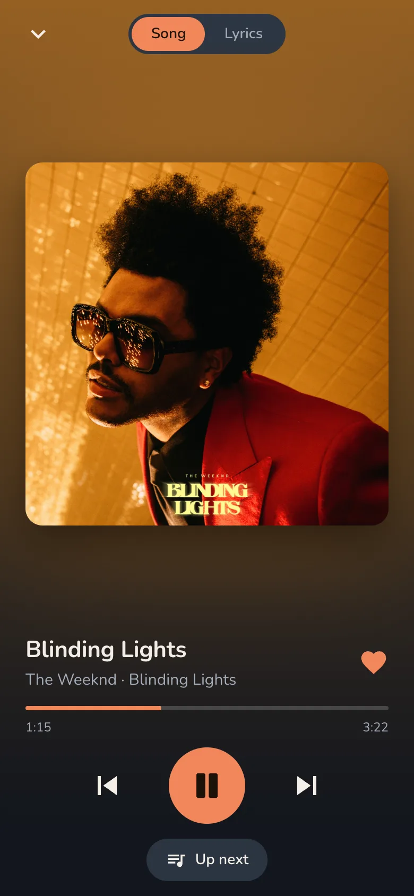
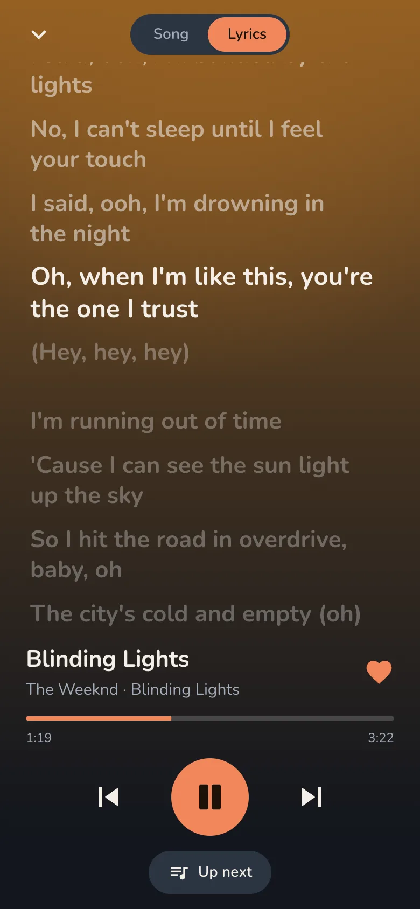
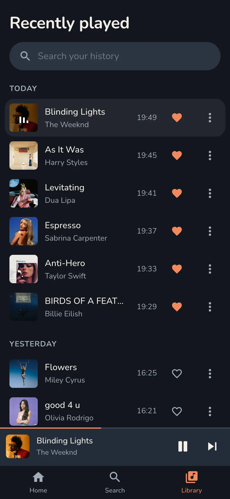
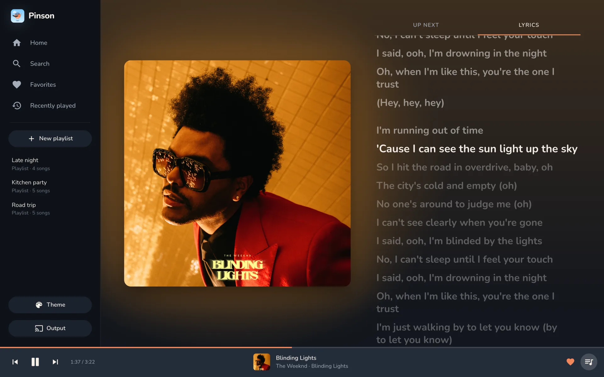
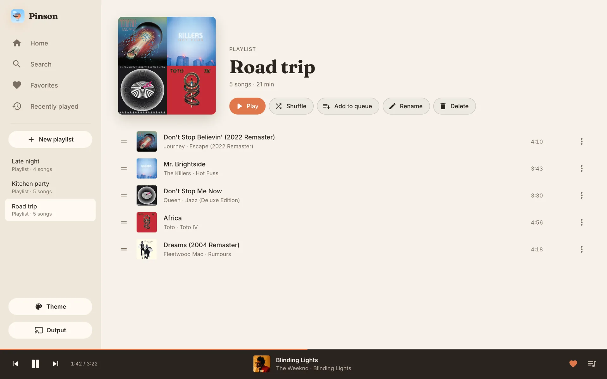
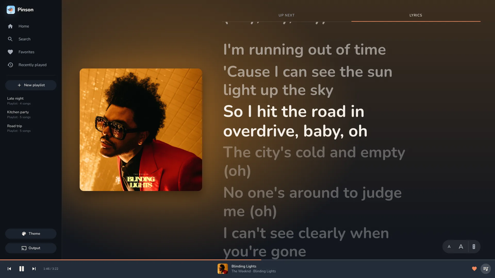

# Pinson


*Gekkotron*

Pinson (French for chaffinch, as in *gai comme un pinson*) is a small house music server and music app. It does the following:

- Searches YouTube Music for songs, albums and playlists (suggests searches as you type), and opens an album or playlist to play it, shuffle it or add it to the queue.
- Keeps a "play next" queue.
- Autoplay: when the queue ends, keeps playing songs like the last queued one (from the YouTube Music radio), and lists them under Up next.
- Mixes for you on Home: the YouTube Music radio of songs you played recently or favorited.
- Remembers favorite songs (one tap shuffles and plays them all).
- Keeps every song you play; find one again in Recently played (search it, grouped by day).
- Stores your own playlists (create, rename, reorder, save an album as a playlist).
- Shows synced lyrics from LRCLIB, with plain lyrics from LRCLIB or YouTube Music as a fallback.
- Plays the queue on the output you choose: this browser tab ("This device"), the home speakers through `nidoo-sound`, Snapcast clients, Chromecast devices, UPnP/DLNA renderers and Sonos speakers, AirPlay 1 speakers, a `/stream.mp3` link for VLC or a browser, this computer's sound card, or a log-only output for trying it out.

## Screenshots



<p>
  
  
  
  
</p>

<p>
  
  
</p>



From the top: Home on a laptop; Home, Now playing, lyrics and Recently played on a phone; Now playing and a playlist (Matin theme) on a laptop; the `/lyrics` view on a TV. The library is a demo one, played with `--engine log`.

## How it works

Audio comes from `yt-dlp` piped into `ffmpeg`, then streams as paced PCM over TCP to [`nidoo-sound`](https://github.com/Gekkotron/Nidoo/tree/main/crates/nidoo-sound), the home audio service that drives the speakers. The server also serves a web app (a phone layout and a laptop layout) and an HTTP/WebSocket API on port 8082.

**Choosing where music plays.** On first run the web app asks "Where should the music play?". The picker offers **This device** first, then Nidoo (with the address of `nidoo-sound`), Snapcast, Stream URL, This computer, and one row per Chromecast, per UPnP/DLNA renderer and per AirPlay 1 speaker found on the network. This computer appears only when the server has a usable sound card. The choice is saved for the next start. The Output button (sidebar, and Home on a phone) reopens the picker. `--engine` / `MUSIC_ENGINE` fixes the output at startup instead (`nidoo`, `snapcast`, `chromecast`, `upnp`, `airplay`, `stream`, `local` or `log`); a choice made in the app is remembered only when `MUSIC_ENGINE` is not set. `--engine log` gives a silent, log-only output for trying Pinson out. The Speakers button shows only when the current output supports it.

**This device.** Open the web app on a phone or laptop and tap **This device** in the output picker: that tab plays the music, with lock-screen controls. Pinson streams it as MP3 (192 kbit/s, encoded with `ffmpeg`). The page must stay open, but it can be in the background or the screen can lock. The phone keeps playing with the screen locked (tested on Android with Chrome; iPhone is untested). If the tab closes or its connection drops cleanly, Pinson pauses after about 10 s (a silent network loss is not detected) and the output stays "This device". Reopen the page and it is the player again, paused. Another browser takes over with **Play here** on Now playing.

**Sendspin speakers.** [`nidoo-sound`](https://github.com/Gekkotron/Nidoo/tree/main/crates/nidoo-sound) is a Sendspin-compatible server, so Pinson plays on any [Sendspin](https://www.sendspin-audio.com/) player it finds: Nidoo satellites, other Sendspin speakers, or a browser player. Every approved player plays the same music in sync. On Nidoo, the Speakers sheet has an "Also play on this device" switch that makes this browser one of them. Pinson itself does not speak Sendspin; it only feeds `nidoo-sound`.

**Snapcast.** Pinson can feed a [Snapcast](https://github.com/badaix/snapcast) server, which plays the same music in sync on every Snapcast client. Add this line to `snapserver.conf`, under `[stream]`:

```ini
source = tcp://0.0.0.0:4953?name=Pinson&mode=server&sampleformat=48000:16:2
```

In `mode=server`, snapserver listens and Pinson connects to it. In the picker, type the snapserver address (`host:4953`). A snapserver found on the network by mDNS fills in its address for you. The Speakers button lists every Snapcast client, with its volume and mute. Pausing stops the stream; snapserver plays what it already buffered (about 1 s).

**Chromecast.** Pinson can play on a Chromecast, a Google Nest speaker or any other Cast device. Devices on the same network show up in the picker by themselves (mDNS), one row each. Pick one and tap Use. Inside Docker, discovery needs `network_mode: host`, which `compose.yml` already uses.

The device fetches the music from Pinson over HTTP, so Pinson's port (`--port`, 8082 by default) must accept inbound TCP from the device. Pinson tells the device its own address on the network facing it. If the device must use another address, for example behind a proxy, set `MUSIC_PUBLIC_URL` (`http://` or `https://`). If the device can't fetch the stream, Pinson pauses and logs `the Cast device couldn't play <url>: check MUSIC_PUBLIC_URL and the firewall`.

To start on a Chromecast, set `MUSIC_ENGINE=chromecast` and `MUSIC_CHROMECAST` to its name, its Cast id (with or without dashes) or `host:port`. A bare host gets port 8009. Pinson also keeps a device it was using when it goes offline: the row stays as the current output.

The Speakers button gives the device one speaker, `cast`, with volume and mute. The song title, artist and artwork show on the device. Pausing or resuming on the device, or from the Google Home app, pauses or resumes Pinson. When another app takes the device, Pinson pauses. There is a gap of 1 to 3 s between songs while the device loads the next one, and the same gap after a seek. The device keeps Pinson's receiver app across songs and seeks; when the queue ends, Pinson stops the app after 20 s, so the device goes back to idle.

**UPnP / DLNA and Sonos.** Pinson can play on a UPnP/DLNA media renderer: many smart TVs, network receivers and speakers, and Sonos. Renderers on the same network show up in the picker by themselves (SSDP), one row each. Inside Docker, discovery needs `network_mode: host`, which `compose.yml` already uses.

Like a Cast device, the renderer fetches the music from Pinson over HTTP, so Pinson's port (`--port`) must accept inbound TCP from it, and `MUSIC_PUBLIC_URL` applies the same way. If the renderer can't fetch the stream, Pinson pauses and logs `the renderer couldn't play <url>: check MUSIC_PUBLIC_URL and the firewall`.

To start on one, set `MUSIC_ENGINE=upnp` and `MUSIC_UPNP` to its friendly name, its UDN (with or without `uuid:`) or its description URL. The Speakers button gives the renderer one speaker, `upnp`, with volume and mute. Pausing or resuming on the device (its remote or app) pauses or resumes Pinson, and when another source takes the renderer, Pinson pauses. There is a gap of 1 to 3 s between songs while the renderer loads the next one, and the same gap after a seek. The position is polled from the renderer, so it is accurate to about 1 s. Sonos plays Pinson's music as a radio stream, so the song title may not show on its app.

**AirPlay 1.** Pinson can play on AirPlay 1 (RAOP) speakers, such as an AirPort Express or a receiver app on a computer. Speakers on the same network show up in the picker by themselves (mDNS, `_raop._tcp`), one row each. Inside Docker, discovery needs `network_mode: host`, which `compose.yml` already uses. Speakers protected by a password are not listed. AirPlay 2-only speakers (a HomePod, for example) may be listed but won't play: Pinson pauses and logs why (they need pairing).

AirPlay 1 buffers about 2 s of audio in the speaker, so pause, skip and seek take about 2 s to be heard. `MUSIC_AIRPLAY_LATENCY_MS` sets that buffer (500 to 5000). The speaker sends timing requests to Pinson over UDP on random ports, so a host firewall must let them through. AirPlay 1 speakers don't report their volume: Pinson sets it when it connects, starting at 50 %. When another device takes the speaker, Pinson pauses.

To start on one, set `MUSIC_ENGINE=airplay` and `MUSIC_AIRPLAY` to its name, its id or `host[:port]` (port 5000 by default). The Speakers button gives the speaker one entry, `airplay`, with volume and mute.

**Stream URL.** While Stream URL is the current output, Pinson serves one endless MP3 (192 kbit/s, 48 kHz stereo) at `http://<pinson host>:8082/stream.mp3`. Open it in VLC or a browser; several listeners at once are fine. It plays silence while paused. The progress bar is approximate, because the player's buffer is unknown; tune `MUSIC_STREAM_LATENCY_MS` to match it. The picker shows the link with a Copy button. Choosing another output ends the stream.

**This computer.** Plays on the server's own default sound card, through `cpal`. The device must do 48 kHz. The Speakers button gives it a software volume, which is not saved across restarts. This is the cargo feature `local-audio`, on by default. On Linux, building it needs `libasound2-dev` and `pkg-config`. `cargo build --no-default-features` leaves it out. The Docker image is built without it, because a container usually can't reach the host's sound card.

## Prerequisites (macOS)

- Install the tools:

  ```sh
  brew install ffmpeg yt-dlp
  ```

- Rust, stable toolchain.
- A reachable `nidoo-sound`, with at least one approved Sendspin player. The default address is `192.168.1.91:4953`; set `MUSIC_NIDOO_SOUND` if yours is elsewhere.

## Run

```sh
cargo run --release
```

Open `http://<this-mac's-ip>:8082` on a phone or laptop on the same network.

**TV.** Open `http://<this-mac's-ip>:8082/lyrics` to go straight to Now playing with the lyrics shown. This big-screen view has a smaller cover, which leaves more room for the lyrics. Save it as a bookmark or shortcut in the TV browser. The pill in the bottom-right corner makes the lyrics bigger or smaller; the size is saved on the TV. The TV remote works too: OK plays or pauses, left and right go to the previous or next song, up and down (or channel +/−) change the text size. Some TV browsers keep the arrows for their own pointer; there, the colour keys play the music (red previous, green pause, yellow play, blue next). If your remote does something else, **Set up your remote** (it opens the first time, then from the remote icon in the pill) asks for each button in turn and saves them on the TV.

Your data lives in `pinson.db`. An existing `favorites.json` or `playlists.json` is imported on the first start.

**Autoplay.** Suggestions come from the YouTube Music radio of the last song in the queue (the playing song if nothing is queued). Songs already queued or played recently are left out. When the queue ends, the first suggestion plays. The Autoplay switch in Up next turns this on or off; the choice is stored in `pinson.db`. It is on by default.

**Mixes.** Home shows up to 6 mixes. Each one is the YouTube Music radio of a seed song, cut to 25 songs. Seeds are the songs you played recently, with different artists first, and your favorites fill in when there is not enough history. A radio that fails or is empty is skipped. Radios are kept for 3 hours.

To try the page without speakers, add `--engine log`. Songs do not play, and they do not advance on their own. Skip still works.

## Run on Linux with Docker

Pinson can run next to `nidoo-sound` on a Linux host. The image brings its own `yt-dlp`, `ffmpeg` and `deno`; the host only needs Docker with Compose.

```sh
git clone https://github.com/Gekkotron/Pinson.git && cd Pinson
mkdir -p data
cp .env.example data/.env   # then fill it in
docker compose up -d --build
```

`pinson.db` and `.env` live in `data/`, which is git-ignored. To move an existing library, stop Pinson and copy `pinson.db` into `data/`. The container uses the host's network, so Pinson answers on the host's port 8082, and `127.0.0.1` reaches a broker or `nidoo-sound` running on the same host.

Logs: `docker compose logs -f pinson`. Update: `./update.sh` pulls the latest code, rebuilds the image and restarts Pinson, which stops the song that is playing; `./update.sh --no-pull` rebuilds the code already checked out. When YouTube breaks playback, raise `YT_DLP_VERSION` in the `Dockerfile` and run `./update.sh`.

## Configuration

Every flag has a matching `MUSIC_*` environment variable. If both are set, the flag wins. Run `cargo run --release -- --help` for the same list.

You can also put these variables in a `.env` file in the folder you start Pinson from. Copy `.env.example` to get started. `.env` is git-ignored, so the MQTT password stays out of the repo. A variable already set in the shell wins over `.env`, and a flag wins over both.

| Flag | Env var | Default | Meaning |
|---|---|---|---|
| `--bind` | `MUSIC_BIND` | `0.0.0.0` | Address to listen on. |
| `--port` | `MUSIC_PORT` | `8082` | Port for the web page and the API. |
| `--yt-dlp` | `MUSIC_YT_DLP` | `yt-dlp` | Path to the `yt-dlp` executable. |
| `--ffmpeg` | `MUSIC_FFMPEG` | `ffmpeg` | Path to the `ffmpeg` executable. |
| `--cookies-from-browser` | `MUSIC_COOKIES_FROM_BROWSER` | unset | Passed to `yt-dlp` as `--cookies-from-browser`, for example `firefox`. |
| `--cookies-file` | `MUSIC_COOKIES_FILE` | unset | Passed to `yt-dlp` as `--cookies`. Netscape cookie file. |
| `--yt-clients` | `MUSIC_YT_CLIENTS` | `visionos` | YouTube clients `yt-dlp` asks for the stream (its `player_client`), comma-separated. `visionos` starts songs about 5 s sooner: the default clients get a pre-roll ad, and `yt-dlp` waits for it. A song that fails with these is retried with `yt-dlp`'s default. Set it empty to always use `yt-dlp`'s default. |
| `--ytm-cookie-file` | `MUSIC_YTM_COOKIE_FILE` | unset | Browser cookie file for YouTube Music search. Use it if anonymous search fails. |
| `--engine` | `MUSIC_ENGINE` | unset: choose in the web app | Startup output: `nidoo` (speakers through nidoo-sound), `snapcast`, `chromecast`, `upnp`, `airplay`, `stream`, `local` (this computer's sound card) or `log` (log calls only, no sound). |
| `--db` | `MUSIC_DB` | `pinson.db` | SQLite file holding favorites, playlists, play history and settings. Relative paths are resolved from the working directory. |
| `--favorites-file` | `MUSIC_FAVORITES_FILE` | `favorites.json` | Old favorites file. Imported into the database once, then renamed to `favorites.json.imported`. |
| `--playlists-file` | `MUSIC_PLAYLISTS_FILE` | `playlists.json` | Old playlists file. Imported into the database once, then renamed to `playlists.json.imported`. |
| `--nidoo-sound` | `MUSIC_NIDOO_SOUND` | `192.168.1.91:4953` | `nidoo-sound` PCM input, as `host:port`. |
| `--nidoo-control` | `MUSIC_NIDOO_CONTROL` | `http://<host of --nidoo-sound>:4954` | `nidoo-sound` HTTP API, as `http://host:port`. Used for each speaker's volume and mute. |
| `--nidoo-player-url` | `MUSIC_NIDOO_PLAYER_URL` | `ws://<host of --nidoo-sound>:8927/sendspin` | `nidoo-sound`'s Sendspin player WebSocket, as `ws://host:port/path`. Browsers that play sound join it. |
| `--nidoo-latency-ms` | `MUSIC_NIDOO_LATENCY_MS` | `750` | Delay from a written byte to the speakers, in ms. Covers `nidoo-sound`'s buffer and lead. |
| `--snapcast` | `MUSIC_SNAPCAST` | a snapserver found by mDNS (port 4953), else `127.0.0.1:4953` | The snapserver tcp source Pinson writes PCM to, as `host:port`. |
| `--snapcast-control` | `MUSIC_SNAPCAST_CONTROL` | `<host of --snapcast>:1705` | snapserver's JSON-RPC control port, as `host:port`. Used for each client's volume and mute. |
| `--snapcast-latency-ms` | `MUSIC_SNAPCAST_LATENCY_MS` | `1200` | Delay from a written byte to the speakers, in ms. Covers snapserver's buffer (1000 ms by default) and Pinson's 200 ms lead. |
| `--chromecast` | `MUSIC_CHROMECAST` | unset: pick one in the web app | Chromecast to play on: its name, its Cast id or `host:port`. Used with `--engine chromecast`. |
| `--upnp` | `MUSIC_UPNP` | unset: pick one in the web app | UPnP/DLNA renderer to play on: its friendly name, its UDN (with or without `uuid:`) or its description URL (`http://host:port/path.xml`). Used with `--engine upnp`. |
| `--airplay` | `MUSIC_AIRPLAY` | unset: pick one in the web app | AirPlay 1 speaker to play on: its name, its id (the MAC address in its mDNS name, such as `0A1B2C3D4E5F`) or `host[:port]` (port 5000 by default). Used with `--engine airplay`. |
| `--airplay-latency-ms` | `MUSIC_AIRPLAY_LATENCY_MS` | `2000` | Delay from a written byte to an AirPlay speaker's output, in ms (500 to 5000). Pause, skip and seek are heard after about this long. |
| `--public-url` | `MUSIC_PUBLIC_URL` | the address facing the device | Where Cast and UPnP devices reach Pinson, as `http://` or `https://`. Set it when Pinson is behind a proxy or another address. |
| `--stream-latency-ms` | `MUSIC_STREAM_LATENCY_MS` | `1000` | How far behind the listener of `/stream.mp3` is assumed to be, in ms. Only moves the progress bar. |
| `--mqtt-broker` | `MUSIC_MQTT_BROKER` | unset: MQTT off | MQTT broker, as `host[:port]`. The port defaults to `1883`. |
| `--mqtt-user` | `MUSIC_MQTT_USER` | unset | MQTT user name, if the broker needs one. |
| `--mqtt-password` | `MUSIC_MQTT_PASSWORD` | unset | MQTT password, if the broker needs one. Optional. Never logged. Prefer the env var: a flag shows in `ps`. Needs `--mqtt-user`. |
| `--mqtt-discovery-prefix` | `MUSIC_MQTT_DISCOVERY_PREFIX` | `homeassistant` | Home Assistant MQTT discovery prefix. |
| `--mqtt-root` | `MUSIC_MQTT_ROOT` | `pinson` | Topic root for Pinson's state, commands and status. |

**Upgrading:** Pinson no longer plays through nidoo-sound unless told to: set `MUSIC_ENGINE=nidoo` to keep the old behaviour. There is no `MUSIC_ENGINE=browser`; to play in a browser tab, pick **This device** in the app.

Logging uses `RUST_LOG`. The default is `info`. For more detail, try `RUST_LOG=debug cargo run --release`.

## Troubleshooting

**Songs fail, or you see "Skipped ..." notices.**
YouTube changes often. Update `yt-dlp`:

```sh
brew upgrade yt-dlp
```

**Premium-only or age-restricted tracks fail.**
Pass your browser cookies to `yt-dlp`:

```sh
cargo run --release -- --cookies-from-browser firefox
```

You can also use a cookie file with `--cookies-file <path>`.

**Search fails (HTTP 502, "search failed").**
Retry first. If anonymous search is blocked, export a browser cookie file and start the server with `--ytm-cookie-file <path>`.

**No sound.**

1. Check that `nidoo-sound` is reachable:

   ```sh
   nc -z 192.168.1.91 4953
   ```

2. Check that the satellite is approved in Nidoo.
3. Look at the server log for `nidoo-sound: ... retrying`.

**The progress bar runs ahead when a song starts.**
This lasts 1 to 3 seconds while the song loads. It corrects itself.

## Themes

The app has three themes, chosen with the **Theme** button (sidebar on a laptop, Home header on a phone) and saved on each device: **Crépuscule** (dark, the default), **Matin** (light paper) and **Ciel** (sky blue). To add one, add an entry to `THEMES` in `web/js/theme.js`, a `[data-theme="<id>"]` block in `web/css/themes.css`, and the same id in the inline script of `web/index.html`.

## Nidoo (MQTT)

Pinson can be a media player for the Nidoo home hub: start it with `--mqtt-broker <host[:port]>` and the hub shows what is playing, tinted with the cover colour, and can play, pause, skip and "play <something>" by voice. It uses Home Assistant-style MQTT discovery. Without a broker, MQTT stays off. Topics, payloads and commands are in [docs/api.md](docs/api.md#mqtt).

## Tests

```sh
cargo test
TZ=Europe/Paris node --test 'tests/web/*.test.mjs'   # web logic (Recently played day grouping)
```

## API

For app developers, see [docs/api.md](docs/api.md) for the HTTP routes, the WebSocket and MQTT.

## License

MIT, see [LICENSE](LICENSE). The fonts in `web/fonts/` (Nunito, Fraunces, Inter, Quicksand) are under the SIL Open Font License, with their license files next to them.

Pinson is a personal project, not affiliated with or endorsed by YouTube or Google. It plays music through `yt-dlp`; using it may go against YouTube's terms of service, so use it for your own listening at home.
